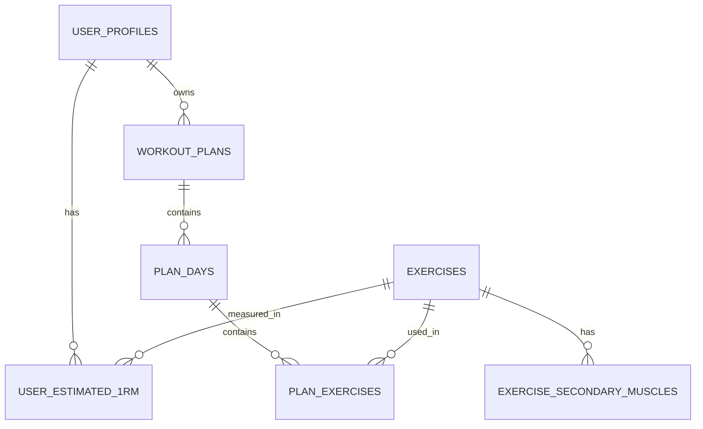

# Слой базы данных

Документ описывает схему SQLite, соответствие доменной модели и контракты репозиториев.

## Файлы

| Файл | Назначение |
|---|---|
| `data/schema.sql` | DDL: таблицы, ограничения, индексы, `PRAGMA user_version` |
| `data/seed.sql` | Базовый каталог из 27 упражнений и вторичных мышечных групп |
| `include/db/Database.h` | Соединение, `Statement` (RAII), транзакции |
| `include/db/UserRepository.h` | Профили пользователей и оценки 1RM |
| `include/db/ExerciseRepository.h` | Справочник упражнений |
| `include/db/PlanRepository.h` | Планы, дни и упражнения плана (DTO) |
| `include/db/SqlTime.h` | ISO 8601 UTC ↔ `time_point` |
| `tests/DatabaseTest.cpp` | Round-trip тесты репозиториев |

## Применение схемы

```bash
sqlite3 workout.db < data/schema.sql
sqlite3 workout.db < data/seed.sql
```

Из C++:

```cpp
workout::infra::Database db("workout.db");
db.executeFile("data/schema.sql");
db.executeFile("data/seed.sql");
```

`Database` включает `PRAGMA foreign_keys = ON` и `busy_timeout` (5 секунд).

## ER-диаграмма



## Таблицы

### `exercises`

Справочник упражнений. Соответствует `workout::core::Exercise` / `ExerciseData`.

| Колонка | Тип | Смысл |
|---|---|---|
| `id` | INTEGER PK | Явный положительный id (без AUTOINCREMENT) |
| `name` | TEXT UNIQUE | Название |
| `description` | TEXT | Описание |
| `primary_muscle` | INTEGER | `MuscleGroup` |
| `structure` | INTEGER | `ExerciseStructure` |
| `kind` | INTEGER | `ExerciseKind` |
| `purpose_type` | INTEGER | `PurposeType` |
| `movement_pattern` | INTEGER | `MovementPattern` |
| `required_equipment` | INTEGER | Битовая маска `Equipment` |
| `optional_equipment` | INTEGER | Битовая маска `Equipment` |
| `difficulty` | INTEGER | 1–5 |
| `met` | REAL | MET, ≥ 0 |
| `estimated_set_duration_sec` | INTEGER | Длительность подхода, > 0 |
| `instructions` | TEXT | Техника |
| `video_url` | TEXT | Ссылка |
| `is_powerlifting_lift` | INTEGER | 0/1 |
| `axial_loading` | INTEGER | 0/1 |
| `spinal_flexion` | INTEGER | 0/1 |
| `overhead_motion` | INTEGER | 0/1 |
| `deep_knee_flexion` | INTEGER | 0/1 |
| `is_unilateral` | INTEGER | 0/1 |
| `regression_id` | INTEGER FK | Более простое упражнение |
| `progression_id` | INTEGER FK | Более сложное упражнение |

### `exercise_secondary_muscles`

`(exercise_id, muscle_group)` — вторичные мышечные группы (`ExerciseData::secondaryMuscles`).
Удаляются каскадно вместе с упражнением.

### `user_profiles`

Соответствует `workout::core::UserProfile` и `BodyMetrics` / `UserConstraints`.

| Колонка | Смысл |
|---|---|
| `id` | PK, AUTOINCREMENT, `-1` в модели = новый профиль |
| `name` | Имя |
| `gender` | `Gender`: 0 Male, 1 Female, 2 Other |
| `height_cm`, `weight_kg` | Антропометрия |
| `body_fat_pct` | `-1.0` = неизвестно |
| `age_years`, `training_age_months` | Возраст и стаж |
| `bmi`, `bmr_kcal`, `tdee_kcal`, `ffmi` | Производные метрики |
| `experience_level` | 0 Novice, 1 Intermediate, 2 Advanced |
| `training_goal` | 0 Strength, 1 Hypertrophy, 2 WeightLoss, 3 Maintenance |
| `training_frequency` | 2–6 дней в неделю |
| `constraints_mask` | Битовая маска `HealthConstraint` |
| `custom_notes` | Свободный текст; пустая строка хранится как `NULL` |
| `available_equipment` | Битовая маска `Equipment` |
| `avoid_axial_loading` | Явная настройка пользователя |
| `avoid_spinal_flexion` | Явная настройка |
| `avoid_overhead_motion` | Явная настройка |
| `avoid_deep_knee_flexion` | Явная настройка |
| `prefer_unilateral` | Предпочтение |
| `max_session_minutes` | `NULL` = без ограничения |
| `created_at`, `updated_at` | ISO 8601 UTC |

Важно: `shouldAvoid*()` в `UserConstraints` — вычисляемые значения (учитывают `constraints_mask`).
В БД хранятся только явные настройки `userAvoid*`, чтобы не терять информацию при повторном сохранении.

### `user_estimated_1rm`

`(profile_id, exercise_id) → weight_kg`. Оценки 1RM, привязаны к профилю и упражнению.
Удаление профиля — каскадное; удаление упражнения, на которое есть 1RM, запрещено (`RESTRICT`).

### `workout_plans`

| Колонка | Смысл |
|---|---|
| `id` | PK |
| `user_id` | FK → `user_profiles`, каскадное удаление |
| `name`, `notes` | Название и заметки |
| `goal` | `TrainingGoal` |
| `days_per_week` | 1–7 |
| `is_active` | Активный план пользователя |
| `created_at`, `updated_at` | ISO 8601 UTC |

Частичный уникальный индекс `idx_workout_plans_one_active` гарантирует **не более одного активного плана** на пользователя.

### `plan_days`

`(plan_id, day_index)` уникально. `day_index` — номер дня, начиная с 0.

### `plan_exercises`

`(plan_day_id, position)` уникально. `weight_kg` может быть `NULL` (вес не задан).
`ON DELETE CASCADE` от `plan_days`; `ON DELETE RESTRICT` от `exercises`.

## Кодирование enum и битовых масок

### Equipment (`includes/core/Types.h`)

| Значение | Бит | Число |
|---|---|---|
| Barbell | 1 << 0 | 1 |
| Dumbbells | 1 << 1 | 2 |
| PowerRack | 1 << 2 | 4 |
| CableMachine | 1 << 3 | 8 |
| Machines | 1 << 4 | 16 |
| PullUpBar | 1 << 5 | 32 |
| DipStation | 1 << 6 | 64 |
| Bands | 1 << 7 | 128 |
| Kettlebells | 1 << 8 | 256 |
| CardioMachines | 1 << 9 | 512 |
| Bench | 1 << 10 | 1024 |

Упражнение доступно, если все биты `required_equipment` присутствуют в `available_equipment`.

### MuscleGroup (`include/core/Exercise.h`)

`0` Chest_Upper, `1` Chest_Lower, `2` Back_Lats, `3` Back_Traps, `4` Back_Rhomboids,
`5` Legs_Quads, `6` Legs_Glutes, `7` Legs_Hamstrings, `8` Legs_Calves,
`9` Shoulders_Front, `10` Shoulders_Side, `11` Shoulders_Rear,
`12` Arms_Biceps, `13` Arms_Triceps, `14` Arms_Forearms,
`15` Core_Abs, `16` Core_Obliques, `17` Core_LowerBack.

### Остальные enum

- `MovementPattern`: Squat 0, Hinge 1, Lunge 2, Push_Horizontal 3, Push_Vertical 4,
  Pull_Horizontal 5, Pull_Vertical 6, Carry 7, Rotation 8, Other 9.
- `ExerciseStructure`: Compound 0, Isolation 1.
- `ExerciseKind`: Resistance 0, Olympic 1, Cardio 2, Mobility 3.
- `PurposeType`: Main 0, Accessory 1, Corrective 2, Conditioning 3, Warmup 4.
- `HealthConstraint`: None 0 … Custom 9. В `constraints_mask` бит = `1 << значение`;
  для `None` маска равна 0.

## Контракты репозиториев

### `UserRepository`

| Метод | Поведение |
|---|---|
| `save(profile)` | `id == -1` → INSERT, иначе UPDATE. 1RM заменяются целиком. Всё в транзакции |
| `findById(id)` | Профиль + 1RM; `nullopt`, если не найден |
| `findAll()` | Все профили по `id` |
| `remove(id)` | `true`, если строка была удалена |

`findById()` не меняет `updatedAt`: 1RM передаются в `UserProfile::createFromDb` отдельной картой.

### `ExerciseRepository`

| Метод | Поведение |
|---|---|
| `findById(id)` / `findByName(name)` | `nullopt`, если не найдено |
| `findAll()` | Все упражнения по `id` |
| `findCompatible(constraints)` | Только `Exercise::isCompatibleWith(constraints)` |
| `save(exercise)` | UPSERT по `id` (id > 0), вторичные мышцы заменяются |
| `remove(id)` | `true`, если удалено; исключение при FK `RESTRICT` |

### `PlanRepository`

Работает с DTO (`PlanRecord`, `PlanDayRecord`, `PlanExerciseRecord`), чтобы не зависеть
от `core::WorkoutPlan` до слияния `feature/plan-generator`.

| Метод | Поведение |
|---|---|
| `save(plan)` | INSERT при `id < 0`, иначе UPDATE. Дни и упражнения заменяются целиком, в транзакции |
| `findById(id)` | План с днями и упражнениями |
| `findByUser(userId)` | Планы пользователя по `id` |
| `setActive(planId)` | Снимает активность с остальных планов пользователя |
| `remove(planId)` | Каскадно удаляет дни и упражнения |

Порядок: `dayIndex < 0` → берётся порядок в векторе; `position < 0` → порядок в векторе.
`sets` и `reps` должны быть > 0, `exerciseId` > 0.

## Инварианты

1. Время хранится только в UTC в формате `YYYY-MM-DDTHH:MM:SSZ`.
2. `body_fat_pct = -1.0` означает «неизвестно»; репозиторий также читает SQL `NULL` как `-1.0`.
3. У пользователя не более одного активного плана.
4. Удаление профиля каскадно удаляет его 1RM и планы.
5. Упражнение нельзя удалить, пока оно используется в 1RM или плане.
6. `exercises.id` задаётся явно и должен быть положительным при сохранении через репозиторий.

## Версионирование схемы

`PRAGMA user_version = 1;` фиксируется в `schema.sql`. Механизма применения миграций пока нет:
при изменении схемы нужно либо пересоздать БД, либо добавить миграции и увеличить версию.

## Тесты

`tests/DatabaseTest.cpp` подключается к CTest и проверяет:

- загрузку схемы и seed;
- round-trip профиля, 1RM и `updatedAt`;
- UPSERT и удаление упражнений;
- сохранение/обновление плана, переключение активного плана, каскадное удаление;
- соблюдение внешнего ключа для 1RM.

Путь к данным передаётся через `WORKOUT_DATA_DIR`.