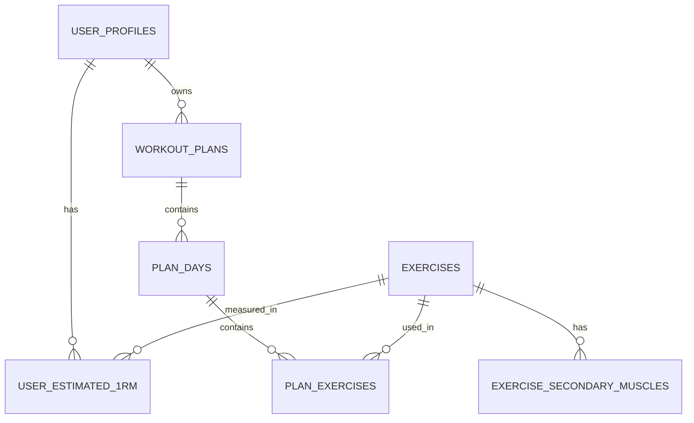

# Database layer

This document describes the SQLite schema, how it maps to the domain model, and the repository contracts.

## Files

| File | Purpose |
|---|---|
| `data/schema.sql` | DDL: tables, constraints, indexes, `PRAGMA user_version` |
| `data/seed.sql` | Base catalog of 27 exercises and secondary muscle groups |
| `include/db/Database.h` | Connection, `Statement` (RAII), transactions |
| `include/db/UserRepository.h` | User profiles and 1RM estimates |
| `include/db/ExerciseRepository.h` | Exercise catalog |
| `include/db/PlanRepository.h` | Plans, plan days and plan exercises (DTO) |
| `include/db/SqlTime.h` | ISO 8601 UTC ↔ `time_point` |
| `tests/DatabaseTest.cpp` | Repository round-trip tests |

## Applying the schema

```bash
sqlite3 workout.db < data/schema.sql
sqlite3 workout.db < data/seed.sql
```

From C++:

```cpp
workout::infra::Database db("workout.db");
db.executeFile("data/schema.sql");
db.executeFile("data/seed.sql");
```

`Database` enables `PRAGMA foreign_keys = ON` and sets `busy_timeout` (5 seconds). Transactions
are tracked by the wrapper: a second `beginTransaction()` before `commit()`/`rollback()` throws
`std::logic_error`, because SQLite has no nested transactions.

## ER diagram



## Tables

### `exercises`

Exercise catalog. Maps to `workout::core::Exercise` / `ExerciseData`.

| Column | Type | Meaning |
|---|---|---|
| `id` | INTEGER PK | Explicit positive id (no AUTOINCREMENT) |
| `name` | TEXT UNIQUE | Name |
| `description` | TEXT | Description |
| `primary_muscle` | INTEGER | `MuscleGroup` |
| `structure` | INTEGER | `ExerciseStructure` |
| `kind` | INTEGER | `ExerciseKind` |
| `purpose_type` | INTEGER | `PurposeType` |
| `movement_pattern` | INTEGER | `MovementPattern` |
| `required_equipment` | INTEGER | `Equipment` bitmask |
| `optional_equipment` | INTEGER | `Equipment` bitmask |
| `difficulty` | INTEGER | 1–5 |
| `met` | REAL | MET, ≥ 0 |
| `estimated_set_duration_sec` | INTEGER | Set duration, > 0 |
| `instructions` | TEXT | Technique notes |
| `video_url` | TEXT | Link |
| `is_powerlifting_lift` | INTEGER | 0/1 |
| `axial_loading` | INTEGER | 0/1 |
| `spinal_flexion` | INTEGER | 0/1 |
| `overhead_motion` | INTEGER | 0/1 |
| `deep_knee_flexion` | INTEGER | 0/1 |
| `is_unilateral` | INTEGER | 0/1 |
| `regression_id` | INTEGER FK | Easier variation |
| `progression_id` | INTEGER FK | Harder variation |

### `exercise_secondary_muscles`

`(exercise_id, muscle_group)` — secondary muscle groups (`ExerciseData::secondaryMuscles`).
Rows are removed together with the exercise via cascade.

### `user_profiles`

Maps to `workout::core::UserProfile` and `BodyMetrics` / `UserConstraints`.

| Column | Meaning |
|---|---|
| `id` | PK, AUTOINCREMENT; `-1` in the model means a new profile |
| `name` | Name |
| `gender` | `Gender`: 0 Male, 1 Female, 2 Other |
| `height_cm`, `weight_kg` | Anthropometry |
| `body_fat_pct` | `-1.0` = unknown |
| `age_years`, `training_age_months` | Age and training experience |
| `bmi`, `bmr_kcal`, `tdee_kcal`, `ffmi` | Derived metrics |
| `experience_level` | 0 Novice, 1 Intermediate, 2 Advanced |
| `training_goal` | 0 Strength, 1 Hypertrophy, 2 WeightLoss, 3 Maintenance |
| `training_frequency` | 2–6 days per week |
| `constraints_mask` | `HealthConstraint` bitmask |
| `custom_notes` | Free-form text; an empty string is stored as `NULL` |
| `available_equipment` | `Equipment` bitmask |
| `avoid_axial_loading` | Explicit user preference |
| `avoid_spinal_flexion` | Explicit user preference |
| `avoid_overhead_motion` | Explicit user preference |
| `avoid_deep_knee_flexion` | Explicit user preference |
| `prefer_unilateral` | User preference |
| `max_session_minutes` | `NULL` = no limit |
| `created_at`, `updated_at` | ISO 8601 UTC |

Note: `shouldAvoid*()` on `UserConstraints` are computed values (they take `constraints_mask`
into account). The database stores only the explicit `userAvoid*` preferences, so no information
is lost when the profile is saved again.

### `user_estimated_1rm`

`(profile_id, exercise_id) → weight_kg`. 1RM estimates tied to a profile and an exercise.
Deleting a profile cascades; deleting an exercise that has a 1RM entry is blocked (`RESTRICT`).

### `workout_plans`

| Column | Meaning |
|---|---|
| `id` | PK |
| `user_id` | FK → `user_profiles`, cascade delete |
| `name`, `notes` | Name and notes |
| `goal` | `TrainingGoal` |
| `days_per_week` | 1–7 |
| `is_active` | The user's active plan |
| `created_at`, `updated_at` | ISO 8601 UTC |

The partial unique index `idx_workout_plans_one_active` guarantees **at most one active plan**
per user.

### `plan_days`

`(plan_id, day_index)` is unique. `day_index` is a zero-based day number.

### `plan_exercises`

`(plan_day_id, position)` is unique. `weight_kg` may be `NULL` (weight not set).
`ON DELETE CASCADE` from `plan_days`; `ON DELETE RESTRICT` from `exercises`.

## Encoding of enums and bitmasks

### Equipment (`include/core/Types.h`)

| Value | Bit | Number |
|---|---|---|
| Barbell | 1 << 0 | 1 |
| Dumbbells | 1 << 1 | 2 |
| PowerRack | 1 << 2 | 4 |
| CableMachine | 1 << 3 | 8 |
| Machines | 1 << 4 | 16 |
| PullUpBar | 1 << 5 | 32 |
| DipStation | 1 << 6 | 64 |
| Bands | 1 << 7 | 128 |
| Kettlebells | 1 << 8 | 256 |
| CardioMachines | 1 << 9 | 512 |
| Bench | 1 << 10 | 1024 |

An exercise is available when all `required_equipment` bits are present in `available_equipment`.

### MuscleGroup (`include/core/Exercise.h`)

`0` Chest_Upper, `1` Chest_Lower, `2` Back_Lats, `3` Back_Traps, `4` Back_Rhomboids,
`5` Legs_Quads, `6` Legs_Glutes, `7` Legs_Hamstrings, `8` Legs_Calves,
`9` Shoulders_Front, `10` Shoulders_Side, `11` Shoulders_Rear,
`12` Arms_Biceps, `13` Arms_Triceps, `14` Arms_Forearms,
`15` Core_Abs, `16` Core_Obliques, `17` Core_LowerBack.

### Other enums

- `MovementPattern`: Squat 0, Hinge 1, Lunge 2, Push_Horizontal 3, Push_Vertical 4,
  Pull_Horizontal 5, Pull_Vertical 6, Carry 7, Rotation 8, Other 9.
- `ExerciseStructure`: Compound 0, Isolation 1.
- `ExerciseKind`: Resistance 0, Olympic 1, Cardio 2, Mobility 3.
- `PurposeType`: Main 0, Accessory 1, Corrective 2, Conditioning 3, Warmup 4.
- `HealthConstraint`: None 0 … Custom 9. In `constraints_mask` a bit is `1 << value`;
  for `None` the mask is 0.

## Repository contracts

### `UserRepository`

| Method | Behavior |
|---|---|
| `save(profile)` | `id == -1` → INSERT, otherwise UPDATE. 1RM entries are replaced as a whole. Runs in a transaction |
| `findById(id)` | Profile + 1RM; `nullopt` if not found |
| `findAll()` | All profiles ordered by `id`; 1RM values are loaded in one extra query |
| `remove(id)` | `true` if the row was deleted |

`findById()` does not change `updatedAt`: 1RM values are passed to
`UserProfile::createFromDb` as a separate map.

### `ExerciseRepository`

| Method | Behavior |
|---|---|
| `findById(id)` / `findByName(name)` | `nullopt` if not found |
| `findAll()` | All exercises ordered by `id` |
| `findCompatible(constraints)` | Exercises compatible with the constraints; filtering runs in SQL, not in memory |
| `save(exercise)` | UPSERT by `id` (id > 0); secondary muscles are replaced |
| `remove(id)` | `true` if deleted; throws on the `RESTRICT` foreign key |

### `PlanRepository`

Works with DTOs (`PlanRecord`, `PlanDayRecord`, `PlanExerciseRecord`) so that it does not
depend on `core::WorkoutPlan` before `feature/plan-generator` is merged.

| Method | Behavior |
|---|---|
| `save(plan)` | INSERT when `id < 0`, otherwise UPDATE. Days and exercises are replaced as a whole, in a transaction |
| `findById(id)` | Plan with its days and exercises |
| `findByUser(userId)` | The user's plans ordered by `id` |
| `setActive(planId)` | Clears the active flag on the user's other plans |
| `remove(planId)` | Deletes days and exercises via cascade |

Ordering: `dayIndex < 0` → the position in the vector is used; `position < 0` → the position
in the vector is used. `sets` and `reps` must be > 0, `exerciseId` > 0.

## Invariants

1. Time is stored in UTC only, in the `YYYY-MM-DDTHH:MM:SSZ` format.
2. `body_fat_pct = -1.0` means "unknown"; the repository also reads SQL `NULL` as `-1.0`.
3. A user has at most one active plan.
4. Deleting a profile cascades to its 1RM entries and plans.
5. An exercise cannot be deleted while it is used in a 1RM entry or a plan.
6. `exercises.id` is assigned explicitly and must be positive when saved through the repository.

## Schema versioning

`PRAGMA user_version = 1;` is set in `schema.sql`. There is no migration runner yet: when the
schema changes, either recreate the database or add migrations and bump the version.

## Tests

`tests/DatabaseTest.cpp` is wired into CTest and verifies:

- schema and seed loading;
- profile, 1RM and `updatedAt` round-trip;
- exercise UPSERT and removal;
- plan save/update, switching the active plan, cascade delete;
- the foreign key constraint for 1RM.

The data path is passed through `WORKOUT_DATA_DIR`.